# Love Live School Idol Festival Tomodachi app

This project is a Love Live School Idol Festival app using data from [School Idol Tomodachi](https://schoolido.lu/) and [LLSIF.net](https://llsif.net/)

The game is dead, no new contents, database is still up, so it becomes my tech playground.

## Content

The project contains:

- [React Native](https://reactnative.dev/)
- [React Navigation](https://reactnavigation.org/)
- [HeroUI](https://heroui.com/en/docs/native/getting-started)
- [apisauce](https://github.com/infinitered/apisauce)
- [React Native Turbo Image](https://github.com/duguyihou/react-native-turbo-image)
- [React Native Awesome Gallery](https://github.com/pavelbabenko/react-native-awesome-gallery)
- [React Native Offline](https://github.com/rgommezz/react-native-offline)
- [React Native Vector Icons](https://github.com/oblador/react-native-vector-icons)
- [React Native MMKV Storage](https://github.com/ammarahm-ed/react-native-mmkv-storage)
- [dayjs](https://day.js.org/)
- And more...

## Directory layout

- [`src/assets`](src/assets): images used by the application
- [`src/components`](src/components): presentational components
- [`src/config`](src/config): configuration of the application
- [`src/modals`](src/modals): modals
- [`src/routes`](src/routes): routes
- [`src/screens`](src/screens): application's screens
- [`src/services`](src/services): application services, e.g. API clients
- [`src/utils`](src/utils): some utility tools

## Running the project

Assuming you have all the requirements installed, you can setup and run the project by running:

- `yarn install` or `npm i` to install the dependencies
- `react-native run-android` to run the Android application (remember to start a simulator or connect an Android phone)
- `react-native run-ios` to run the iOS application (remember to start a simulator or connect an iPhone phone)

## Review

| Light                     | Dark                           |
| ------------------------- | ------------------------------ |
| 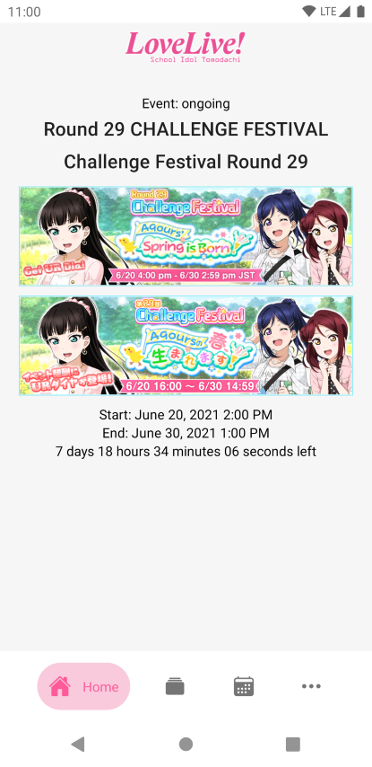 | 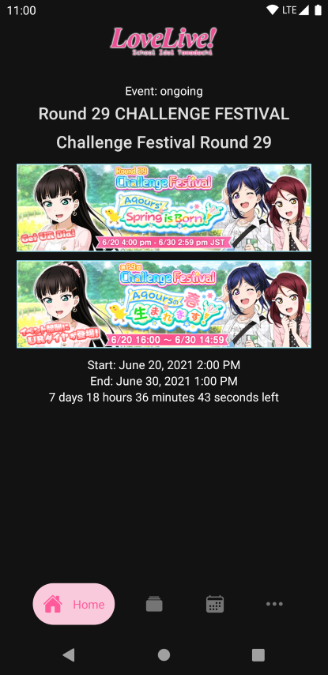 |
| 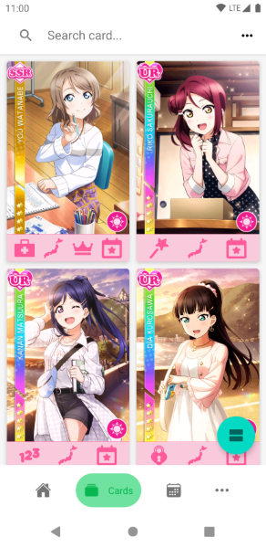 | 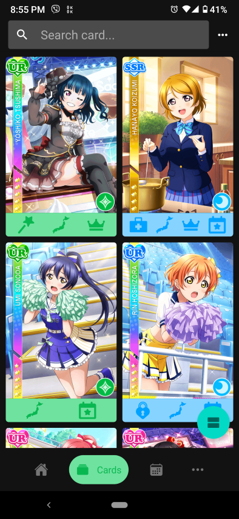 |
| 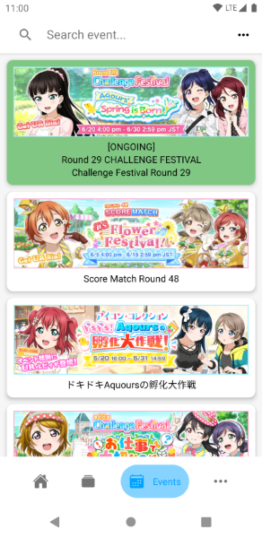 | 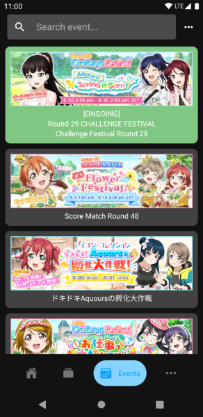 |
| 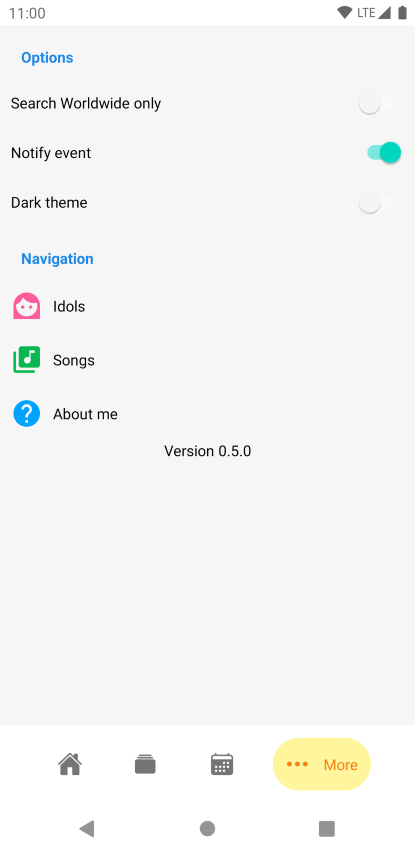 | 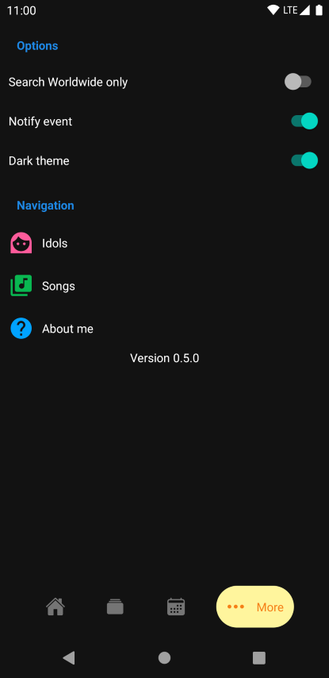 |
| 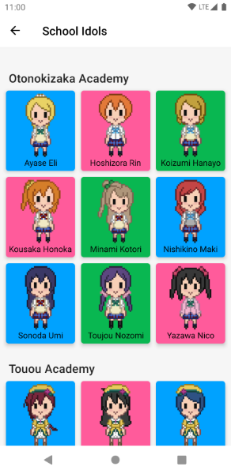 | 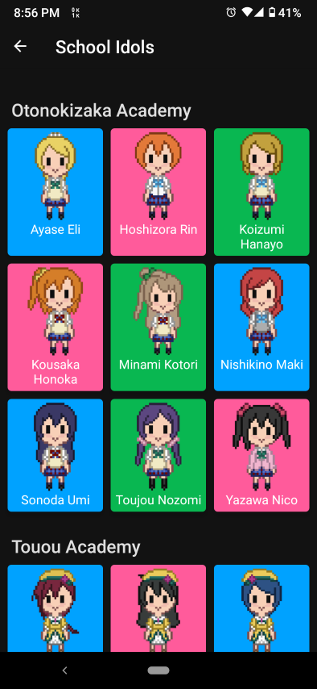 |
| 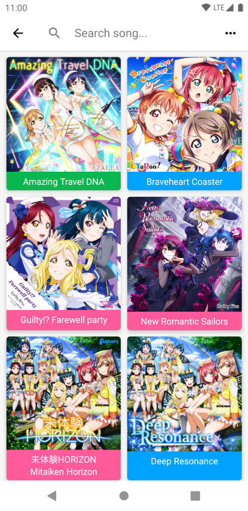 | 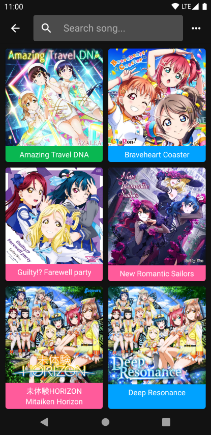 |
| 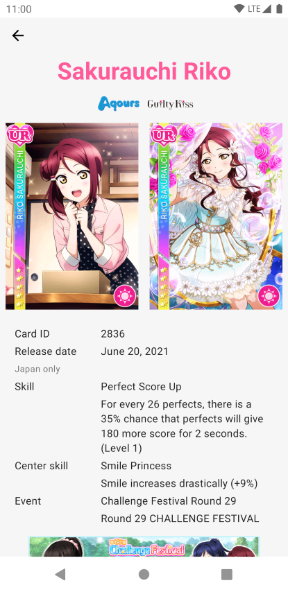 | 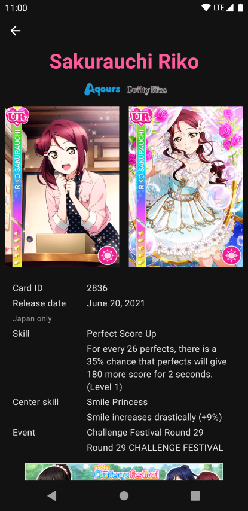 |
| 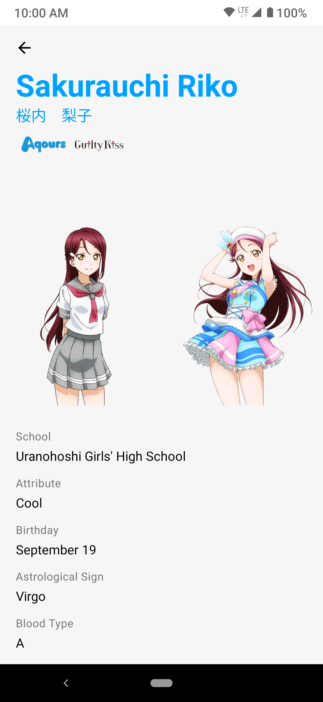 | 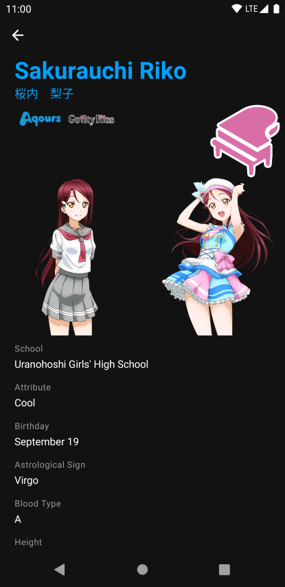 |
| 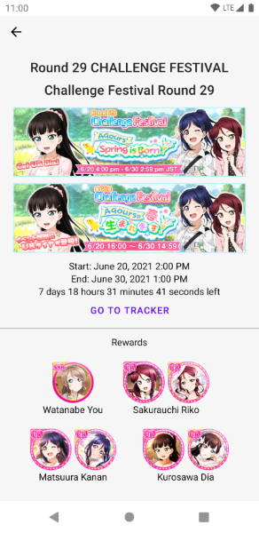 | 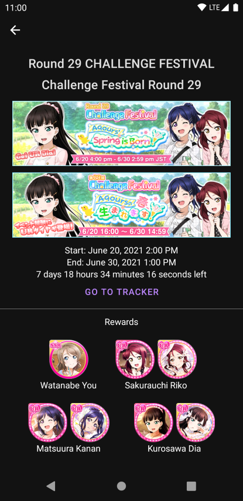 |
| 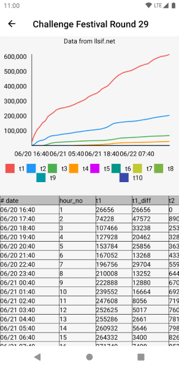 | 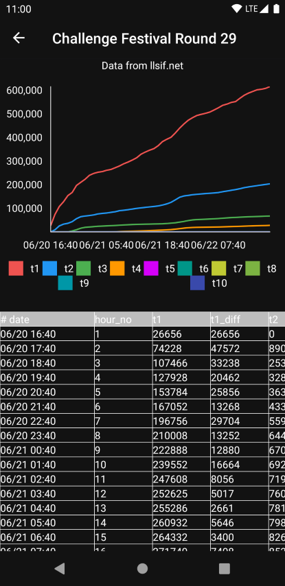 |
| 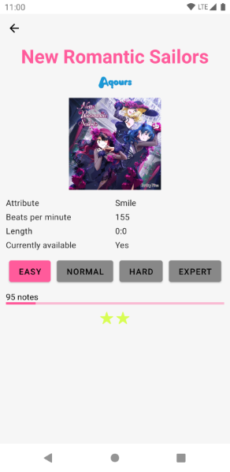 | 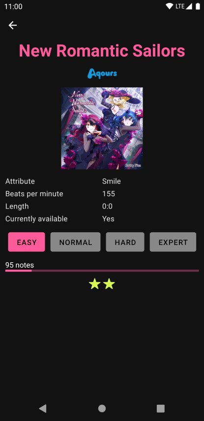 |

## Author

Phạm Ngọc Thạch

I'm a React Native developer, play Love Live, BanGDream, Starlight everyday.

## License

© Phạm Ngọc Thạch

This project is released under the [MIT License](LICENSE).
